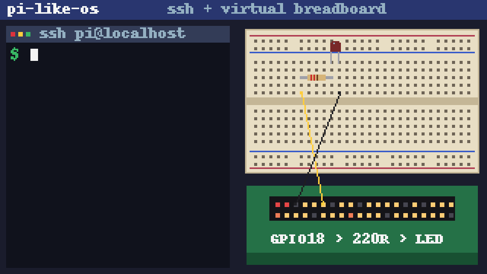

# pi-like-os: a Raspberry Pi you can ssh into, plus a virtual breadboard

[繁體中文](README.md) | **English**



Run unmodified gpiozero code on Mac or Windows.
You do not need a Raspberry Pi, a breadboard or parts.
You only need Docker Desktop.

pi-like-os has two parts:

- **Pi container**: a Linux system that looks like a new Raspberry Pi 4. You connect to it with ssh and install software yourself.
- **Virtual breadboard**: a web page. You connect wires on the page. Your Pi program controls the parts on the page.

You do not change your Pi program. The same program also runs on a real Raspberry Pi.

> **Note**: The virtual breadboard page is in English or Traditional Chinese. It uses the language of your browser.
> To change the language, click **中文** or **English** at the top right of the page.
> Some messages in the Pi container are in Traditional Chinese only. This document gives their English meaning.

---

## Terms

This document uses these terms. Each term has one meaning only.

| Term | Meaning |
|---|---|
| Computer | Your Mac or Windows computer |
| Pi container | The "Raspberry Pi" that runs on your computer |
| sim container | The program that supplies the virtual breadboard page |
| Virtual breadboard | The web page http://localhost:8080 |
| SD card | The location where the Pi container keeps its files. The software that you install is here |
| Pi program | A Python program for a real Raspberry Pi (for example, a program that uses gpiozero) |
| Terminal | "Terminal" on Mac, or "PowerShell" on Windows |

---

## 1. Prepare the computer

1. Install [Docker Desktop](https://www.docker.com/products/docker-desktop/).
2. Open Docker Desktop.
3. Wait until Docker Desktop shows "running".

| Computer | Necessary items |
|---|---|
| Mac (Apple M1 to M4) | Docker Desktop only |
| Mac (Intel) | Docker Desktop only |
| Windows | Docker Desktop and WSL 2. Virtualization must be on in the BIOS |

## 2. Download pi-like-os

1. Open https://github.com/Isaac-Lin-0519/pi-like-os .
2. Click the green "Code" button.
3. Click "Download ZIP".
4. Extract the ZIP file to a folder.

If you use git, you can use this command:

```bash
git clone https://github.com/Isaac-Lin-0519/pi-like-os.git
```

## 3. Start

1. Open the pi-like-os folder.
2. Double-click the start file:
   - Mac: `start.command`
   - Windows: `start.bat`
3. Wait until the start is complete. The first start downloads the programs. This takes some minutes.
4. The browser opens the virtual breadboard.

You can also start from a terminal:

```bash
docker compose up -d
```

## 4. Connect to the Pi container

1. Open a terminal.
2. Type this command:

```bash
ssh pi@localhost -p 2222
```

3. The password is `raspberry`.

| Use | Address |
|---|---|
| Virtual breadboard | http://localhost:8080 |
| phpMyAdmin (you install it) | http://localhost:8081/phpmyadmin |
| Jupyter (you install it) | http://localhost:8888 |
| Gradio (you start it) | http://localhost:7860 |

Only your computer can connect to these addresses. Other computers on the same network cannot connect.

To transfer files with FileZilla, use SFTP, host `localhost`, port `2222`, user `pi`, password `raspberry`.

---

## 5. Install software

The Pi container has **no** lab software installed. Install the software that your lab tells you to install.
This is an example. Do these steps in the Pi container.

1. Install the system packages:

```bash
sudo apt update
sudo apt install -y mariadb-server virtualenvwrapper
```

2. Set up virtualenvwrapper:

```bash
echo 'export WORKON_HOME=$HOME/.virtualenvs' >> ~/.bashrc
echo 'source /usr/share/virtualenvwrapper/virtualenvwrapper.sh' >> ~/.bashrc
source ~/.bashrc
```

3. Make the `ai` environment and install the Python packages:

```bash
mkvirtualenv ai
workon ai
pip install gpiozero lgpio pymysql
pip install gradio jupyter
```

4. Install phpMyAdmin. When the installer asks for a web server, select `apache2`:

```bash
sudo apt install -y phpmyadmin
```

MariaDB and apache2 start after the installation. They also start each time the Pi container starts.

## 6. Run the LED program

1. Open the virtual breadboard.
2. In "Example circuits", select "LED blink (GPIO18)".
   The circuit is: GPIO18 (physical pin 12) → 220Ω resistor → LED long leg. LED short leg → GND.
3. In the Pi container, run:

```bash
workon ai
cd ~/shared/examples
python led.py
```

4. Look at the virtual breadboard. The LED is on for 3 seconds and off for 1 second.
5. Press `Ctrl+C` to stop the program. The program shows 「實驗已停止。」 (Experiment stopped.).

If a wire is incorrect, the LED does not come on. "Circuit hints" tells you what is incorrect.

`shared/examples/led_savetodb.py` writes the LED state into MariaDB. The top of the file has the SQL that makes the database, the user and the table.

## 7. Share files with the computer

The `shared` folder on your computer is `/home/pi/shared` in the Pi container.

1. On the computer, edit a file in `shared` with VS Code.
2. In the Pi container, run the file.

---

## 8. Use the virtual breadboard

| Task | Procedure |
|---|---|
| Add a part | Drag the part from the toolbox on the left to the breadboard. The legs of the part go into the holes |
| Connect a jumper wire | Drag from a header pin or a hole to a different hole. Or: click the start point, then click the end point |
| Select the wire color | Before you connect the wire, select a color in "Jumper wires" |
| See which holes connect | Move the mouse over a hole. Connected holes have a green circle. The page shows the voltage |
| Move a part | Drag the part |
| Move one end of a wire | Select the wire. Drag its end |
| Turn a part | Select the part. Press `R` |
| Delete | Select the part or the wire. Press `Delete` |
| Change a resistor value or an LED color | Select the part. Change it in "Selected part" |
| Push a button | Hold the mouse button down on the button = pushed. Release the mouse button = released |
| Turn the potentiometer | Drag up or down on the knob. Or use the mouse wheel. Or move the slider in "Selected part" |
| Load an example | Select one in "Example circuits" |
| Save | Not necessary. The page saves the circuit automatically |
| Save to a file | Click "Export". Click "Import" to load a file |
| Change the language | Click "中文" or "English" at the top right. The page remembers your selection |

### Parts

The breadboard has the standard size (63 columns). The Raspberry Pi is below the breadboard.

| Part | Description |
|---|---|
| LED | Red, green, yellow, blue. Select white in "Selected part" |
| RGB LED | 4 legs: red R, common (longest), green G, blue B. The default is common cathode |
| Resistor | 100Ω, 220Ω, 330Ω, 1kΩ, 10kΩ, 47kΩ, 100kΩ, 1MΩ. The color bands are the same as on real resistors |
| Button | 4 legs. The button must go across the center gap of the breadboard |
| Potentiometer | Rotary, 10kΩ (B10K). 3 legs: two outer legs and the center leg (wiper) |
| MCP3008 | 8-channel analog-to-digital converter. The chip must go across the center gap of the breadboard |

### Circuit hints

The virtual breadboard calculates the full circuit with nodal analysis. It shows hints from the result:

| Condition | Hint |
|---|---|
| The LED is on correctly | The current, and the estimate `(3.3V − 2V) ÷ 220Ω ≈ 5.9mA` |
| No current-limiting resistor | The current is more than 16mA. A real GPIO pin can be damaged |
| The resistor is too large (for example 1MΩ) | The current is only some µA. The LED is almost off |
| The LED is reversed | The long leg (+) must connect to the GPIO or 3V3 side |
| Both legs of a part are in the same column | The part is short-circuited |
| A GPIO output or 3V3 connects to GND | Short circuit |
| 5V connects to a GPIO pin | This damages the Raspberry Pi |
| An input pin has no fixed voltage (floating) | The value changes randomly. Use a pull-up or a pull-down |
| The MCP3008 is connected incorrectly | The hint shows the incorrect pin and the correct connection |
| The potentiometer wiper connects to the power supply | At the end of the travel, this is a short circuit |

---

## 9. MCP3008 and potentiometer

1. In "Example circuits", select "Three-step knob meter". The circuit is:

   | MCP3008 pin | Name | Connects to | Pi physical pin |
   |---|---|---|---|
   | 16 | VDD | 3.3V | 1 |
   | 15 | VREF | 3.3V | 1 |
   | 14 | AGND | GND | 6 |
   | 13 | CLK | GPIO11 (SCLK) | 23 |
   | 12 | DOUT | GPIO9 (MISO) | 21 |
   | 11 | DIN | GPIO10 (MOSI) | 19 |
   | 10 | CS/SHDN | GPIO8 (CE0) | 24 |
   | 9 | DGND | GND | 6 |
   | 1 | CH0 | Potentiometer wiper | — |

2. Run the Pi program. With gpiozero:

```python
from gpiozero import MCP3008
pot = MCP3008(channel=0)
print(pot.value)
```

3. Turn the potentiometer on the virtual breadboard. The value in the program changes.
4. Select the MCP3008. "Selected part" shows the voltage and the code of each channel, and the value that the program read.

`shared/examples/meter.py` is a full example. When you turn the potentiometer, the three LEDs on GPIO17, 27 and 22 come on one by one.

You can also use spidev. First run `pip install spidev`:

```python
import spidev
spi = spidev.SpiDev()
spi.open(0, 0)
r = spi.xfer2([1, (8 + 0) << 4, 0])
value = ((r[1] & 3) << 8) + r[2]
```

On a real Raspberry Pi, turn on SPI first: `sudo raspi-config` → Interface Options → SPI → Yes.
SPI is already on in the Pi container. In the Pi container, `raspi-config` only shows a note.

---

## 10. SD card: keep your software

The Pi container keeps `/etc`, `/usr`, `/var`, `/home`, `/root`, `/opt` and `/srv` on the SD card.

| Action | Data on the SD card |
|---|---|
| Run `sudo reboot` in the Pi container | Kept. The Pi container starts again after approximately 10 seconds |
| Run `sudo poweroff` in the Pi container | Kept. Start it with `docker compose start pi` |
| `docker compose stop` or `docker compose down` | Kept |
| Restart the computer or Docker Desktop | Kept |
| **`docker compose down -v`** | **All deleted** |

### Reinstall the Pi container

> **WARNING**: A reinstall deletes all the software that you installed, the databases and the circuit on the breadboard. The `shared` folder is not deleted.

1. Run:

```bash
docker compose down -v
docker compose up -d
```

2. ssh shows `REMOTE HOST IDENTIFICATION HAS CHANGED`. Run this command, then connect again:

```bash
ssh-keygen -R "[localhost]:2222"
```

### Back up the SD card

These steps save the SD card as `backup/sd-card.tar.gz`.

1. Stop the Pi container:

```bash
docker compose stop pi
```

2. Make the backup:

```bash
docker run --rm -v pi-like-os_sd-etc:/sd/etc -v pi-like-os_sd-usr:/sd/usr -v pi-like-os_sd-var:/sd/var -v pi-like-os_sd-home:/sd/home -v pi-like-os_sd-root:/sd/root -v pi-like-os_sd-opt:/sd/opt -v pi-like-os_sd-srv:/sd/srv -v "$PWD/backup:/backup" debian:trixie-20261104 tar czf /backup/sd-card.tar.gz -C /sd .
```

3. Start the Pi container:

```bash
docker compose start pi
```

## 11. Update to a new version

The GitHub Releases page shows the new version number, for example 0.2.0.

1. Download the new pi-like-os (section 2). If you use git, run `git pull`.
2. If you downloaded a ZIP file, copy your files from the old `shared` folder to the new `shared` folder.
3. Start in the new folder (double-click the start file, or run this command):

```bash
docker compose up -d
```

The new `docker-compose.yml` has the new version number. Your computer does not have this version, thus Docker downloads it.
The data on the SD card is kept.

To see the current version, run:

```bash
docker compose images
```

---

## 12. Differences from a real Raspberry Pi

### No systemd

The Pi container has no systemd. Use the `service` command:

| Real Raspberry Pi | Pi container |
|---|---|
| `sudo systemctl start mariadb` | `sudo service mariadb start` |
| `sudo systemctl stop mariadb` | `sudo service mariadb stop` |
| `sudo systemctl restart apache2` | `sudo service apache2 restart` |
| `systemctl status mariadb` | `sudo service mariadb status` |
| `sudo systemctl enable mariadb` | `sudo update-rc.d mariadb enable` |
| `sudo systemctl disable mariadb` | `sudo update-rc.d mariadb disable` |
| `journalctl -u mariadb` | Read the log files in `/var/log/` |

You can also type `systemctl`. The Pi container changes it to `service` and shows the command that it runs.
`journalctl` and `systemctl list-timers` do not work.

### Other differences

| Item | Pi container |
|---|---|
| `uname -m` | `aarch64` on Mac (the same as 64-bit Pi OS). `x86_64` on Windows |
| `free`, `/proc/meminfo` | Shows the Docker memory, not 2GB |
| `/dev/gpiochip*`, `/dev/spidev*` | Not available. GPIO and SPI data goes to the virtual breadboard |
| SPI | Only an MCP3008 on SPI0 (CE0, CE1) |
| I2C, serial port | Not available yet |
| `raspi-config` | Shows a note only. `raspi-config nonint get_spi` returns 0 (SPI is on) |
| `pinctrl`, `vcgencmd`, camera | Not available yet. `pinout` is available |
| Circuit | Direct current only. PWM shows as average brightness. Parts are not damaged; the page shows a hint |
| apt sources | Debian only. No archive.raspberrypi.com |
| `pip install` | Shows `Looking in indexes: http://sim:8000/simple`. A real Raspberry Pi uses piwheels |
| Time zone | Asia/Taipei |

## 13. Troubleshooting

| Problem | Solution |
|---|---|
| The program shows 「連不到虛擬麵包板」 (Cannot connect to the virtual breadboard) | The sim container is not running. Run `docker compose up -d` |
| `pip install` or `apt update` is very slow or fails | Make sure that the computer has a good internet connection. Try a different network |
| `python: command not found` | Go into a virtual environment first (`workon ai`). The system has `python3` only |
| ssh shows `Connection refused` | The Pi container is still starting. Wait 10 seconds and try again. Use `docker compose ps` to see the status |
| Port 2222 or 8080 is already in use | In `docker-compose.yml`, change the number to the left of the colon in `ports` |
| The program shows `lgpio.error: 'GPIO busy'` | A different program uses the same pin. Stop that program. A real Raspberry Pi does the same |
| The MCP3008 value is always 0 | Read "Circuit hints". If the chip is not connected correctly, the program reads 0 |
| Jupyter does not open | Use the address that the terminal shows. The address contains `token=` |
| The virtual breadboard does not update | Reload the page |
| The page shows "Connected" but the Pi container is off | This is correct. "Connected" shows the connection between the page and the sim container. "Running programs" shows the Pi programs that use GPIO |

---

## 14. For developers

### How it works

```
Computer
├─ Browser: virtual breadboard
│     ▲ WebSocket
├─ sim container: web page, pin bridge, pip package index
│     ▲ TCP (pin and SPI data)
└─ Pi container: Pi program → gpiozero → lgpio (simulated)
```

- gpiozero uses lgpio first.
- In the Pi container, `/etc/pip.conf` sets the sim container as the pip index.
  `pip install lgpio` and `pip install spidev` install the simulated versions. Other packages come from PyPI.
- The simulated lgpio has the same functions, constants and error messages as the real lgpio. It sends pin changes to the virtual breadboard.
- The gpiozero `MCP3008` class uses `spi_open` and `spi_xfer` from lgpio. The sim container replies bit by bit, with the timing in the MCP3008 datasheet.
- `/proc/cpuinfo` and `/proc/device-tree/model` have the contents of a Pi 4B rev 1.5.
- The output of `pinout` comes from the real gpiozero.
- The virtual breadboard calculates the circuit in the browser. When the page is closed, input pins and the MCP3008 do not update.
- All text on the page is in `sim/static/i18n.js`. To add a language, add a set of strings with the same keys. The tests make sure that all languages have the same keys.

### Develop on your computer

1. Copy the development settings to `docker-compose.override.yml`:

```bash
cp docker-compose.override.example.yml docker-compose.override.yml
```

2. Build from the source code and start:

```bash
docker compose up -d --build
```

3. Run the tests for the circuit calculation (Node.js is necessary):

```bash
node sim/tests/circuit.test.mjs
```

`docker-compose.override.yml` is not sent to GitHub. A computer without this file downloads the built images.

### Version rules

All versions are fixed. Do not use `latest`. Do not use ranges such as `>=`.

| Item | Method | Location |
|---|---|---|
| pi-like-os images | Version number, for example `0.1.0` | `docker-compose.yml` |
| Base images | Date tag and `@sha256` | `pi/Dockerfile`, `sim/Dockerfile` |
| Python packages | `==` version, also for indirect dependencies | `sim/requirements.txt`, `pi/Dockerfile` |
| GitHub Actions | Commit SHA, with the version in a comment | `.github/workflows/images.yml` |

apt packages have no fixed version. The base image is fixed to one Debian 13 release. `apt install` installs from the Debian 13 package sources.
Debian 13 packages get security fixes only. They do not change to new versions.

To upgrade an item: change the version → build → test → release a new version.

### Release a new version

1. Commit all changes.
2. Run the release script. The script changes the version in `docker-compose.yml`, runs the tests, commits and adds a tag:

```bash
scripts/release.sh 0.2.0
```

3. Push:

```bash
git push && git push origin v0.2.0
```

4. GitHub Actions runs the tests, then builds the amd64 and arm64 images. This takes approximately 10 to 20 minutes.
5. The images go to `ghcr.io/isaac-lin-0519/pi-like-os/pi:0.2.0` and `ghcr.io/isaac-lin-0519/pi-like-os/sim:0.2.0`.
6. Make a Release on GitHub with the new version number and the list of changes. Users update with section 11.

If you push to `main` without a tag, GitHub Actions only tests and builds. It does not push images.
If the version in `docker-compose.yml` and the tag are different, GitHub Actions fails and does not push.

After the first release, make sure that the images are public:
GitHub → your avatar → Your packages → `pi-like-os/pi` → Package settings → Change visibility → Public.
Do the same for `pi-like-os/sim`.

---

## License

pi-like-os uses the [MIT License](LICENSE). The licenses of other projects are in [THIRD_PARTY_NOTICES.md](THIRD_PARTY_NOTICES.md).

Raspberry Pi is a trademark of Raspberry Pi Ltd. pi-like-os is not related to Raspberry Pi Ltd.
