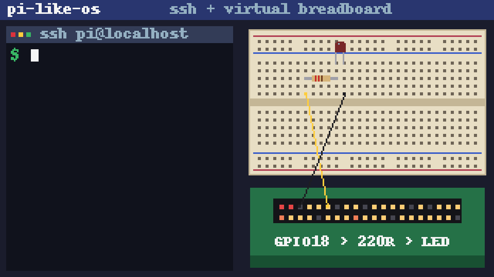

# pi-like-os：樹莓派居家練習環境

**繁體中文** | [English](README.en.md)



pi-like-os 讓你用 Mac 或 Windows 做樹莓派實驗。
你不需要真的樹莓派，也不需要麵包板和零件。
你只需要 Docker Desktop。

pi-like-os 有兩個部分：

- **Pi 容器**：一台像剛灌好的 Raspberry Pi 4 的 Linux。你用 ssh 連進去，自己安裝軟體。
- **虛擬麵包板**：一個網頁。你在網頁上接線，Pi 程式控制網頁上的零件。

Pi 程式不用改。同一個程式也可以在真的樹莓派上執行。

---

## 用詞

本文件用以下的詞。每個詞只有一個意思。

| 詞 | 意思 |
|---|---|
| 電腦 | 你的 Mac 或 Windows 電腦 |
| Pi 容器 | 在電腦上執行的「樹莓派」 |
| sim 容器 | 提供虛擬麵包板網頁的程式 |
| 虛擬麵包板 | 網頁 http://localhost:8080 |
| SD 卡 | Pi 容器存放檔案的地方。你安裝的軟體都在這裡 |
| Pi 程式 | 為真的樹莓派寫的 Python 程式（例如使用 gpiozero） |
| 終端機 | Mac 的「終端機」，或 Windows 的「PowerShell」 |

---

## 1. 準備電腦

1. 安裝 [Docker Desktop](https://www.docker.com/products/docker-desktop/)。
2. 打開 Docker Desktop。
3. 等 Docker Desktop 顯示「running」。

| 電腦 | 需要的東西 |
|---|---|
| Mac（Apple M1～M4） | 只要 Docker Desktop |
| Mac（Intel） | 只要 Docker Desktop |
| Windows | Docker Desktop 和 WSL 2。BIOS 的「虛擬化」必須開啟 |

## 2. 下載 pi-like-os

1. 打開 https://github.com/Isaac-Lin-0519/pi-like-os 。
2. 按綠色的「Code」按鈕。
3. 按「Download ZIP」。
4. 把 ZIP 檔解壓縮到一個資料夾。

會用 git 的人可以改用這個指令：

```bash
git clone https://github.com/Isaac-Lin-0519/pi-like-os.git
```

## 3. 啟動

1. 打開 pi-like-os 資料夾。
2. 雙擊啟動檔：
   - Mac：`start.command`
   - Windows：`start.bat`
3. 等啟動完成。第一次要下載程式，需要幾分鐘。
4. 瀏覽器會自動打開虛擬麵包板。

你也可以在終端機裡啟動：

```bash
docker compose up -d
```

## 4. 連進 Pi 容器

1. 打開終端機。
2. 輸入這個指令：

```bash
ssh pi@localhost -p 2222
```

3. 密碼是 `raspberry`。

| 用途 | 網址 |
|---|---|
| 虛擬麵包板 | http://localhost:8080 |
| phpMyAdmin（你自己安裝） | http://localhost:8081/phpmyadmin |
| Jupyter（你自己安裝） | http://localhost:8888 |
| Gradio（你自己執行） | http://localhost:7860 |

只有你的電腦可以連到這些網址。同一個網路的其他電腦不能連。

用 FileZilla 傳檔案：協定選 SFTP，主機 `localhost`，連接埠 `2222`，使用者 `pi`，密碼 `raspberry`。

---

## 5. 安裝軟體

Pi 容器裡**沒有**預先安裝實驗用的軟體。請照你的實驗步驟安裝。
以下是一個例子。請在 Pi 容器裡執行。

1. 安裝系統套件：

```bash
sudo apt update
sudo apt install -y mariadb-server virtualenvwrapper
```

2. 設定 virtualenvwrapper：

```bash
echo 'export WORKON_HOME=$HOME/.virtualenvs' >> ~/.bashrc
echo 'source /usr/share/virtualenvwrapper/virtualenvwrapper.sh' >> ~/.bashrc
source ~/.bashrc
```

3. 建立 `ai` 環境，並安裝 Python 套件：

```bash
mkvirtualenv ai
workon ai
pip install gpiozero lgpio pymysql
pip install gradio jupyter
```

4. 安裝 phpMyAdmin。安裝畫面問網頁伺服器時，選 `apache2`：

```bash
sudo apt install -y phpmyadmin
```

MariaDB 和 apache2 安裝後會自動啟動。Pi 容器重新開機後，它們也會自動啟動。

## 6. 執行 LED 程式

1. 打開虛擬麵包板。
2. 在「範例電路」選「LED 閃爍（GPIO18）」。
   電路是：GPIO18（實體腳位 12）→ 220Ω 電阻 → LED 長腳。LED 短腳 → GND。
3. 在 Pi 容器裡執行：

```bash
workon ai
cd ~/shared/examples
python led.py
```

4. 看虛擬麵包板。LED 亮 3 秒，暗 1 秒。
5. 按 `Ctrl+C` 停止程式。程式顯示「實驗已停止。」。

如果接錯，LED 不會亮。「電路提示」會說明錯在哪裡。

`shared/examples/led_savetodb.py` 把 LED 的狀態寫進 MariaDB。檔案開頭有建立資料庫、帳號和資料表的 SQL。

## 7. 和電腦共用檔案

電腦上的 `shared` 資料夾，就是 Pi 容器裡的 `/home/pi/shared`。

1. 在電腦上用 VS Code 編輯 `shared` 裡的檔案。
2. 在 Pi 容器裡執行這個檔案。

---

## 8. 使用虛擬麵包板

| 要做的事 | 方法 |
|---|---|
| 放零件 | 把零件從左邊的工具箱拖到麵包板上。零件的腳會自動對準孔 |
| 接杜邦線 | 從排針或孔拖到另一個孔。或：按起點，再按終點 |
| 選杜邦線顏色 | 接線前，在「杜邦線」選顏色 |
| 看哪些孔相通 | 把滑鼠移到孔上。相通的孔有綠色圓圈，並顯示電壓 |
| 移動零件 | 拖零件 |
| 移動杜邦線的一端 | 選杜邦線，拖它的端點 |
| 旋轉零件 | 選零件，按 `R` |
| 刪除 | 選零件或杜邦線，按 `Delete` |
| 改電阻值、LED 顏色 | 選零件，在「選取的元件」裡改 |
| 按按鈕 | 在按鈕上按住滑鼠 = 按下。放開滑鼠 = 放開 |
| 轉可變電阻 | 在旋鈕上上下拖。或用滑鼠滾輪。或在「選取的元件」裡拉滑桿 |
| 載入範例 | 在「範例電路」選一個 |
| 存檔 | 不用做。電路自動存檔 |
| 存成檔案 | 按「匯出」。按「匯入」可以載入檔案 |

### 零件

麵包板是標準尺寸（63 行）。樹莓派在麵包板下方。

| 零件 | 說明 |
|---|---|
| LED | 紅、綠、黃、藍。白色在「選取的元件」裡選 |
| RGB LED | 4 支腳：紅 R、共同腳（最長）、綠 G、藍 B。預設是共陰極 |
| 電阻 | 100Ω、220Ω、330Ω、1kΩ、10kΩ、47kΩ、100kΩ、1MΩ。色環和材料包的電阻一樣 |
| 按鈕 | 4 支腳。按鈕要跨在麵包板中間的溝上 |
| 可變電阻 | 旋轉式，10kΩ（B10K）。3 支腳：兩側的腳和中間的腳（滑動端） |
| MCP3008 | 8 通道類比轉數位晶片。晶片要跨在麵包板中間的溝上 |

### 電路提示

虛擬麵包板用「節點電壓法」計算整個電路。它依計算結果顯示提示：

| 狀況 | 提示 |
|---|---|
| LED 正常亮 | 電流，和 `(3.3V − 2V) ÷ 220Ω ≈ 5.9mA` 的估算 |
| 沒有限流電阻 | 電流超過 16mA。真的 GPIO 可能燒壞 |
| 電阻太大（例如 1MΩ） | 電流只有幾 µA。LED 幾乎不亮 |
| LED 接反 | 長腳（＋）要接 GPIO 或 3V3 那一側 |
| 零件的兩支腳在同一排 | 零件被短路 |
| GPIO 輸出接 GND、3V3 接 GND | 短路 |
| 5V 接到 GPIO | 會燒壞樹莓派 |
| 輸入腳沒有接到確定的電壓（浮接） | 讀值會亂跳。請用上拉或下拉 |
| MCP3008 接錯 | 指出哪一支腳接錯，要接到哪裡 |
| 可變電阻的中間腳接到電源 | 轉到底時會短路 |

---

## 9. MCP3008 與可變電阻

1. 在「範例電路」選「三段旋鈕儀表」。電路如下：

   | MCP3008 腳 | 名稱 | 接到 | Pi 實體腳位 |
   |---|---|---|---|
   | 16 | VDD | 3.3V | 1 |
   | 15 | VREF | 3.3V | 1 |
   | 14 | AGND | GND | 6 |
   | 13 | CLK | GPIO11（SCLK） | 23 |
   | 12 | DOUT | GPIO9（MISO） | 21 |
   | 11 | DIN | GPIO10（MOSI） | 19 |
   | 10 | CS/SHDN | GPIO8（CE0） | 24 |
   | 9 | DGND | GND | 6 |
   | 1 | CH0 | 可變電阻的中間腳 | — |

2. 執行 Pi 程式。gpiozero 的寫法：

```python
from gpiozero import MCP3008
pot = MCP3008(channel=0)
print(pot.value)
```

3. 在虛擬麵包板上轉可變電阻。程式讀到的值會改變。
4. 選 MCP3008。「選取的元件」顯示每個通道的電壓、讀值，和程式讀到的值。

`shared/examples/meter.py` 是完整的例子：轉可變電阻，GPIO17、27、22 的三顆 LED 依序亮起。

spidev 的寫法也可以用。請先執行 `pip install spidev`：

```python
import spidev
spi = spidev.SpiDev()
spi.open(0, 0)
r = spi.xfer2([1, (8 + 0) << 4, 0])
value = ((r[1] & 3) << 8) + r[2]
```

真的樹莓派要先開啟 SPI：`sudo raspi-config` → Interface Options → SPI → Yes。
Pi 容器的 SPI 已經開啟。在 Pi 容器裡執行 `raspi-config`，只會顯示說明。

---

## 10. SD 卡：保存你安裝的軟體

Pi 容器把 `/etc`、`/usr`、`/var`、`/home`、`/root`、`/opt`、`/srv` 存在 SD 卡。

| 動作 | SD 卡的資料 |
|---|---|
| 在 Pi 容器裡執行 `sudo reboot` | 保留。Pi 容器約 10 秒後自動開機 |
| 在 Pi 容器裡執行 `sudo poweroff` | 保留。用 `docker compose start` 開機 |
| `docker compose stop` 或 `docker compose down` | 保留 |
| 重新開機電腦、重新開啟 Docker Desktop | 保留 |
| **`docker compose down -v`** | **全部刪除** |

### 重灌 Pi 容器

> **警告**：重灌會刪除你安裝的所有軟體、資料庫和麵包板上的電路。`shared` 資料夾不會被刪除。

1. 執行：

```bash
docker compose down -v
docker compose up -d
```

2. ssh 會顯示 `REMOTE HOST IDENTIFICATION HAS CHANGED`。執行這個指令，然後再連一次：

```bash
ssh-keygen -R "[localhost]:2222"
```

### 備份 SD 卡

這些步驟把 SD 卡存成 `backup/sd-card.tar.gz`。

1. 停止 Pi 容器：

```bash
docker compose stop pi
```

2. 備份：

```bash
docker run --rm -v pi-like-os_sd-etc:/sd/etc -v pi-like-os_sd-usr:/sd/usr -v pi-like-os_sd-var:/sd/var -v pi-like-os_sd-home:/sd/home -v pi-like-os_sd-root:/sd/root -v pi-like-os_sd-opt:/sd/opt -v pi-like-os_sd-srv:/sd/srv -v "$PWD/backup:/backup" debian:trixie-20261104 tar czf /backup/sd-card.tar.gz -C /sd .
```

3. 啟動 Pi 容器：

```bash
docker compose start pi
```

## 11. 更新到新版

新版的版本號寫在 GitHub 的 Releases 頁面，例如 0.2.0。

1. 下載新版的 pi-like-os（第 2 節）。用 git 的人執行 `git pull`。
2. 如果下載的是 ZIP，把舊資料夾 `shared` 裡你自己的檔案複製到新資料夾的 `shared`。
3. 在新資料夾啟動（雙擊啟動檔，或執行下面的指令）：

```bash
docker compose up -d
```

新版的 `docker-compose.yml` 寫著新的版本號。電腦上沒有這個版本，所以 Docker 自動下載它。
SD 卡的資料會保留。

用這個指令看目前的版本：

```bash
docker compose images
```

---

## 12. 和真的樹莓派不同的地方

### 沒有 systemd

Pi 容器沒有 systemd。請用 `service` 指令：

| 真的樹莓派 | Pi 容器 |
|---|---|
| `sudo systemctl start mariadb` | `sudo service mariadb start` |
| `sudo systemctl stop mariadb` | `sudo service mariadb stop` |
| `sudo systemctl restart apache2` | `sudo service apache2 restart` |
| `systemctl status mariadb` | `sudo service mariadb status` |
| `sudo systemctl enable mariadb` | `sudo update-rc.d mariadb enable` |
| `sudo systemctl disable mariadb` | `sudo update-rc.d mariadb disable` |
| `journalctl -u mariadb` | 看 `/var/log/` 裡的記錄檔 |

你也可以打 `systemctl`。Pi 容器把它改成 `service`，並顯示實際執行的指令。
`journalctl` 和 `systemctl list-timers` 不能用。

### 其他不同

| 項目 | Pi 容器 |
|---|---|
| `uname -m` | Mac 是 `aarch64`（和 64 位元 Pi OS 相同）。Windows 是 `x86_64` |
| `free`、`/proc/meminfo` | 顯示 Docker 的記憶體，不是 2GB |
| `/dev/gpiochip*`、`/dev/spidev*` | 不存在。GPIO 和 SPI 的資料送到虛擬麵包板 |
| SPI | 只有 SPI0（CE0、CE1）上的 MCP3008 |
| I2C、序列埠 | 還沒有 |
| `raspi-config` | 只顯示說明。`raspi-config nonint get_spi` 回傳 0（SPI 已開啟） |
| `pinctrl`、`vcgencmd`、相機 | 還沒有。`pinout` 可以用 |
| 電路 | 只計算直流電。PWM 用平均亮度表示。零件不會燒壞，只會顯示提示 |
| apt 套件來源 | 只有 Debian。沒有 archive.raspberrypi.com |
| `pip install` | 顯示 `Looking in indexes: http://sim:8000/simple`。真的樹莓派是 piwheels |
| 時區 | Asia/Taipei |

## 13. 疑難排解

| 問題 | 解決方法 |
|---|---|
| 程式顯示「連不到虛擬麵包板」 | sim 容器沒有執行。執行 `docker compose up -d` |
| `pip install` 或 `apt update` 很慢或失敗 | 確認電腦的網路正常。可以換一個網路試試 |
| `python: command not found` | 先進入虛擬環境（`workon ai`）。系統只有 `python3` |
| ssh 顯示 `Connection refused` | Pi 容器還在開機。等 10 秒再試。用 `docker compose ps` 看狀態 |
| 2222 或 8080 已經被使用 | 改 `docker-compose.yml` 裡 `ports` 冒號左邊的數字 |
| 程式顯示 `lgpio.error: 'GPIO busy'` | 另一個程式在用同一支腳。停止那個程式。真的樹莓派也會這樣 |
| MCP3008 讀到的都是 0 | 看「電路提示」。晶片沒有接好時，程式讀到 0 |
| Jupyter 打不開 | 用終端機顯示的網址。網址裡有 `token=` |
| 虛擬麵包板沒有更新 | 重新整理網頁 |
| Pi 容器沒有開，網頁卻顯示「已連線」 | 這是正常的。「已連線」是網頁和 sim 容器的連線。「執行中的程式」才顯示正在使用 GPIO 的 Pi 程式 |

---

## 14. 開發者須知

### 運作方式

```
電腦
├─ 瀏覽器：虛擬麵包板
│     ▲ WebSocket
├─ sim 容器：網頁、腳位橋接、pip 套件來源
│     ▲ TCP（腳位、SPI 資料）
└─ Pi 容器：Pi 程式 → gpiozero → lgpio（模擬版）
```

- gpiozero 優先使用 lgpio。
- Pi 容器的 `/etc/pip.conf` 把 pip 的來源設成 sim 容器。
  `pip install lgpio` 和 `pip install spidev` 安裝模擬版。其他套件從 PyPI 下載。
- 模擬版 lgpio 的函式、常數和錯誤訊息都和真的 lgpio 相同。它把腳位的變化送到虛擬麵包板。
- gpiozero 的 `MCP3008` 用 lgpio 的 `spi_open` 和 `spi_xfer`。sim 容器依照 MCP3008 資料手冊的時序，回覆每一個位元。
- `/proc/cpuinfo` 和 `/proc/device-tree/model` 是 Pi 4B rev 1.5 的內容。
- `pinout` 的輸出由真的 gpiozero 預先產生。
- 虛擬麵包板在瀏覽器裡計算電路。網頁沒有打開時，輸入腳和 MCP3008 不會更新。

### 在電腦上開發

1. 把開發設定複製成 `docker-compose.override.yml`：

```bash
cp docker-compose.override.example.yml docker-compose.override.yml
```

2. 從原始碼建立並啟動：

```bash
docker compose up -d --build
```

3. 執行電路計算的測試（需要 Node.js）：

```bash
node sim/tests/circuit.test.mjs
```

`docker-compose.override.yml` 不會上傳到 GitHub。沒有這個檔案的電腦會下載建好的 image。

### 版本規則

所有版本都固定。不使用 `latest`，也不使用 `>=` 這種範圍。

| 東西 | 固定的方法 | 位置 |
|---|---|---|
| pi-like-os 的 image | 版本號，例如 `0.1.0` | `docker-compose.yml` |
| 基底 image | 日期標籤和 `@sha256` | `pi/Dockerfile`、`sim/Dockerfile` |
| Python 套件 | `==` 版本號，包含間接依賴 | `sim/requirements.txt`、`pi/Dockerfile` |
| GitHub Actions | commit SHA，註解寫版本號 | `.github/workflows/images.yml` |

apt 套件沒有固定版本。基底 image 固定在一個 Debian 13 版本，`apt install` 從 Debian 13 的套件來源安裝。
Debian 13 的套件只更新安全修正，不換新版。

要升級一個東西時：改版本號 → 重新建立 → 測試 → 發布新版。

### 發布新版

1. commit 所有修改。
2. 執行發布腳本。腳本改 `docker-compose.yml` 的版本號、執行測試、commit，並加上標籤：

```bash
scripts/release.sh 0.2.0
```

3. 推送：

```bash
git push && git push origin v0.2.0
```

4. GitHub Actions 執行測試，然後建立 amd64 和 arm64 的 image。約需 10～20 分鐘。
5. image 推到 `ghcr.io/isaac-lin-0519/pi-like-os/pi:0.2.0` 和 `ghcr.io/isaac-lin-0519/pi-like-os/sim:0.2.0`。
6. 在 GitHub 建立 Release，寫上新的版本號和修改內容。使用者照第 11 節更新。

推到 `main` 但沒有加標籤時，GitHub Actions 只執行測試和建立，不推送 image。
`docker-compose.yml` 的版本號和標籤不同時，GitHub Actions 會失敗，不會推送。

第一次發布後，確認 image 是公開的：
GitHub → 你的頭像 → Your packages → `pi-like-os/pi` → Package settings → Change visibility → Public。
`pi-like-os/sim` 也做一樣的設定。

---

## 授權

pi-like-os 使用 [MIT 授權](LICENSE)。其他專案的授權列在 [THIRD_PARTY_NOTICES.md](THIRD_PARTY_NOTICES.md)。

Raspberry Pi 是 Raspberry Pi Ltd 的商標。pi-like-os 和 Raspberry Pi Ltd 沒有關係。
